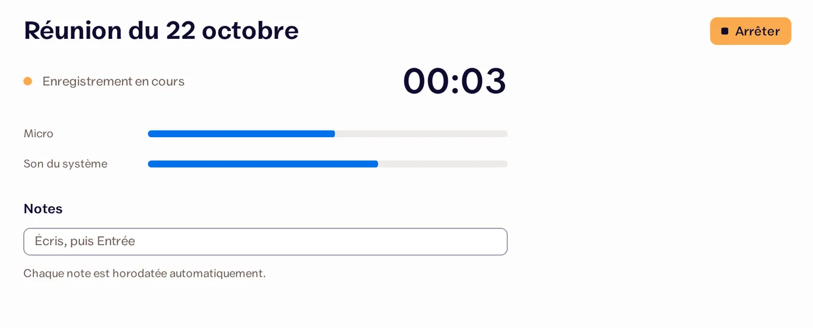
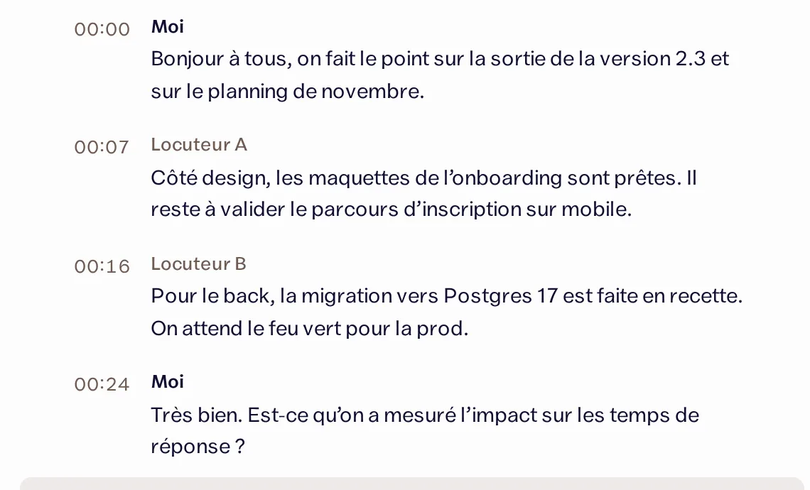
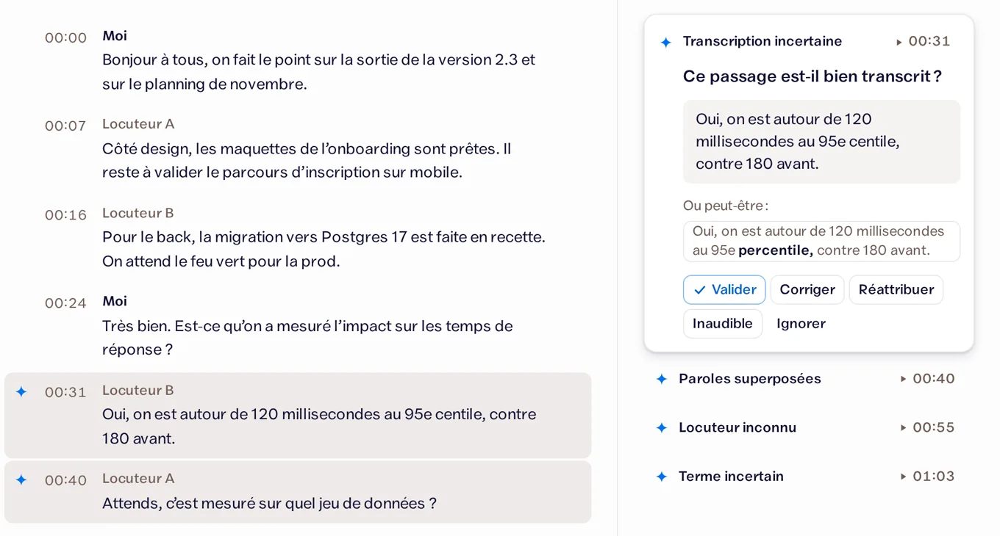

  

<h1 align="center">Barnaby</h1>

  <strong>Arrête de taper. Parle.</strong> 
  Tu parles, Barnaby écrit pour toi, dans n’importe quelle app. Il écrit aussi tes réunions.

  <a href="https://mybarnaby.app"><strong>mybarnaby.app</strong></a> ·
  <a href="https://github.com/jonathanvouilloz/barnaby/releases/latest">Télécharger</a> ·
  <a href="#questions">Questions</a>

  
  
  

Barnaby est une app de bureau gratuite et open source, qui tourne sur ton ordinateur. Par défaut, ta voix ne quitte pas ta machine.

## Ce que fait Barnaby

- **Dictée** : tu appuies sur un raccourci, tu parles, tu appuies encore. Le texte apparaît là où tu écrivais : un mail, un message, un document.
- **Réunions** : en visio ou autour d’une table, Barnaby capte ton micro et le son de l’ordinateur. À la fin, tu as tout le texte, une ligne par personne qui parle, et si tu veux un résumé avec les décisions et les choses à faire.
- **Il te dit quand il doute** : chaque passage incertain porte une étincelle. Tu relis ces quelques minutes au lieu de tout réécouter, puis tu ranges la réunion dans un dossier ou tu l’envoies à ton outil (webhook).

<table>
  <tr>
    <td><picture><source media="(prefers-color-scheme: dark)" srcset="site/img/app/record-dark.webp"></picture></td>
    <td><picture><source media="(prefers-color-scheme: dark)" srcset="site/img/app/transcript-dark.webp"></picture></td>
    <td><picture><source media="(prefers-color-scheme: dark)" srcset="site/img/app/review-dark.webp"></picture></td>
  </tr>
  <tr>
    <td align="center">Barnaby écoute</td>
    <td align="center">Barnaby écrit tout</td>
    <td align="center">Tu vérifies, puis tu envoies</td>
  </tr>
</table>

## Installer

| Système | Fichier | Configuration |
|---|---|---|
| Windows | [Barnaby-windows-setup.exe](https://github.com/jonathanvouilloz/barnaby/releases/latest/download/Barnaby-windows-setup.exe) ([.msi](https://github.com/jonathanvouilloz/barnaby/releases/latest/download/Barnaby-windows.msi)) | Windows 10 ou 11 |
| Mac | [Barnaby-macos-arm64.dmg](https://github.com/jonathanvouilloz/barnaby/releases/latest/download/Barnaby-macos-arm64.dmg) | Puce Apple (M1 et plus récent), macOS 14.2 ou plus récent |
| Linux | [Barnaby-linux-amd64.deb](https://github.com/jonathanvouilloz/barnaby/releases/latest/download/Barnaby-linux-amd64.deb) | Ubuntu, Debian et dérivés |

Les liens pointent toujours vers la dernière version. Toutes les versions et leurs nouveautés : [Releases](https://github.com/jonathanvouilloz/barnaby/releases).

L’app n’est pas signée (la signature coûte cher pour un projet gratuit), donc le système affiche un avertissement à l’installation :

- **Windows** : clique sur « Informations complémentaires », puis sur « Exécuter quand même ».
- **Mac** : ouvre Réglages Système, puis Confidentialité et sécurité, et clique sur « Ouvrir quand même ». Barnaby demande ensuite l’accès au micro, au son de l’ordinateur et à l’Accessibilité (pour coller le texte). Après une mise à jour, macOS peut les redemander.

## Premiers pas

1. Au premier lancement, Barnaby te guide étape par étape et télécharge les modèles de voix dont il a besoin.
2. **Dicter** : <kbd>Ctrl</kbd> <kbd>Alt</kbd> <kbd>Espace</kbd>, tu parles, puis les mêmes touches pour finir. Sur Mac : <kbd>Cmd</kbd> <kbd>Shift</kbd> <kbd>Espace</kbd>.
3. **Enregistrer une réunion** : <kbd>Ctrl</kbd> <kbd>Shift</kbd> <kbd>R</kbd> pour commencer et pour finir. Sur Mac : <kbd>Cmd</kbd> <kbd>Shift</kbd> <kbd>R</kbd>. Barnaby te prévient quand la réunion est prête à relire.

Les raccourcis se changent dans les Réglages.

## Questions

### C’est vraiment gratuit ?
Oui. Pas de compte, pas d’abonnement. La seule option payante : écrire les réunions en ligne avec Mistral, plus rapide sur un petit ordinateur (environ 0,18 $ par heure de réunion, facturé par Mistral avec ta propre clé).

### Où vont mes enregistrements ?
Ils restent sur ton ordinateur. Par défaut, le son d’une réunion est effacé dès que tu l’as relue. Rien ne part en ligne sans que tu l’aies choisi.

### Il me faut quel ordinateur ?
La dictée marche bien sur un ordinateur ordinaire. Pour les réunions, une machine modeste met du temps à tout écrire ; Mistral le fait alors plus vite, en ligne.

### Et les personnes que j’enregistre ?
Préviens-les. Avant chaque réunion, Barnaby te propose un court texte à leur lire, qui dit ce qui est enregistré et où ça va.

## Sous le capot

Tauri 2 et Rust pour l’app, Svelte 5 pour l’interface. La dictée passe par Parakeet v3, les réunions par Whisper large-v3 turbo (ou Mistral Voxtral en option), la séparation des voix par sherpa-onnx (pyannote, WeSpeaker) et Silero VAD.

Pour développer ou compiler soi-même : [AGENTS.md](AGENTS.md) (commandes, prérequis par système). Le produit en détail : [docs/SPEC.md](docs/SPEC.md). L’architecture : [docs/project/architecture.md](docs/project/architecture.md).

## Merci

Barnaby tient debout grâce à d’autres projets ouverts : [Handy](https://handy.computer/) a montré la voie de la dictée libre ; les voix passent par [whisper.cpp](https://github.com/ggml-org/whisper.cpp), [Parakeet](https://huggingface.co/nvidia/parakeet-tdt-0.6b-v3), [sherpa-onnx](https://github.com/k2-fsa/sherpa-onnx), [pyannote](https://github.com/pyannote/pyannote-audio) et [Silero VAD](https://github.com/snakers4/silero-vad) ; l’app est construite avec [Tauri](https://tauri.app/), et la transcription en ligne passe par [Mistral](https://mistral.ai/).

## Licence

Code sous licence MIT (voir [LICENSE](LICENSE)). Logo et chouette sous licence CC BY 4.0.

Fait par Jon, développeur indépendant à Genève : [jonlabs.ch](https://www.jonlabs.ch/) · [@jonvolio](https://x.com/jonvolio).
